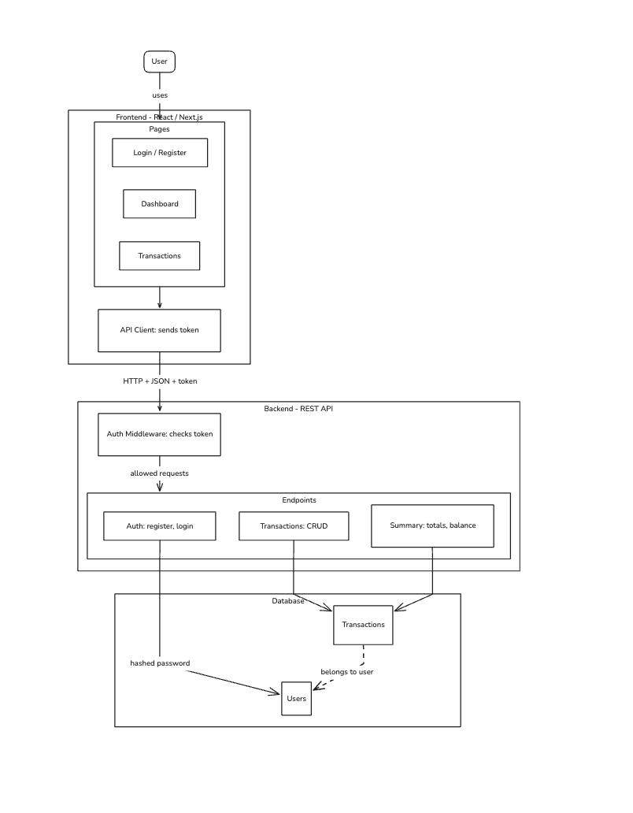

# CashFlow

A full-stack personal budgeting web application. Users create an account, record their income and expenses, and see their total income, total expenses and current balance on a dashboard.

> Status: in development (Phase 1 – Setup and Initialization)

## Features

### Core
- User registration, login and logout (email + password)
- Passwords hashed with bcrypt; JWT-based authentication
- Each user can only see and modify their own transactions
- Add, edit and delete transactions (type, amount, category, date, optional description)
- Dashboard with total income, total expenses and current balance
- Transaction history in chronological order
- Responsive layout for desktop and mobile
- Input validation and error handling on both frontend and backend

### Planned enhancements
- Filtering and sorting by category, type and date
- CSV export
- Category-based charts and monthly summaries
- Category color coding

## Tech Stack

| Layer      | Technology                         |
|------------|------------------------------------|
| Frontend   | React, Vite, React Router          |
| Backend    | Node.js, Express                   |
| Database   | PostgreSQL                         |
| Auth       | bcrypt, JSON Web Tokens (JWT)      |
| API testing| Postman                            |

## Architecture

CashFlow follows a three-layer client-server architecture. The React frontend sends JSON requests over HTTP to the Express REST API, attaching a JWT for authenticated routes. The backend verifies the token, handles business logic and reads/writes data in PostgreSQL, where every transaction belongs to a user.



## Project Structure

```
cashflow-2byte/
├── frontend/     # React + Vite client
├── backend/      # Node.js + Express REST API
└── docs/         # Architecture diagram, screenshots, documentation assets
```

## API Endpoints

| Method | Endpoint                  | Auth | Description                                  |
|--------|---------------------------|------|----------------------------------------------|
| POST   | `/api/auth/register`      | No   | Create a new user                            |
| POST   | `/api/auth/login`         | No   | Log in and receive a JWT                     |
| GET    | `/api/transactions`       | Yes  | List the user's transactions                 |
| POST   | `/api/transactions`       | Yes  | Create a transaction                         |
| PUT    | `/api/transactions/:id`   | Yes  | Update a transaction                         |
| DELETE | `/api/transactions/:id`   | Yes  | Delete a transaction                         |
| GET    | `/api/summary`            | Yes  | Total income, total expenses, balance        |

## Getting Started

### Prerequisites
- [Node.js](https://nodejs.org/) 22 or 24 LTS
- [PostgreSQL](https://www.postgresql.org/) 15+
- [Git](https://git-scm.com/)

### Setup

Setup and run instructions will be added as the frontend and backend are implemented.

```bash
git clone https://github.com/Ioana0825/cashflow-2byte.git
cd cashflow-2byte
```

## License

This project is licensed under the MIT License – see [LICENSE](LICENSE) for details.
